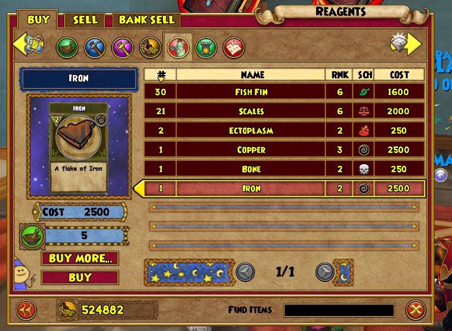

# Wizard101 Bazaar Reagent Bot

Use this bot to buy **any reagent sold in the Wizard101 Bazaar**, one reagent at a time. Type its in-game name and select the category where it appears. The bot searches every page of that category, buys as much matching stock as your wizard can afford, and keeps refreshing for more. You can start with a completely empty tab.

For example, enter `Iron` to buy Iron or `Brass` to buy Brass. Pressing Enter at the name prompt chooses `Outsider Relic`, the default. You can choose a different reagent each time you start the bot. It reads names on screen and clicks the Bazaar controls using your mouse.

## Installation

You need Windows, the English Wizard101 client, Python 3.12, and Windows PowerShell 5.1 with English text recognition (OCR) available. The buyer gets its font from your installed copy of Wizard101. Deimos is optional and can stay closed.

On GitHub, choose **Code → Download ZIP** and extract it, or clone the repository with Git. Open PowerShell in the folder containing `Start Bazaar Buyer.cmd` and run these commands once.

```powershell
py -3.12 -m venv .venv
.\.venv\Scripts\python.exe -m pip install -r requirements.txt
```

If your Python installation provides `python` instead of `py`, use `python -m venv .venv` for the first command. You can use the environment directly without activating it.

## Buy a reagent

1. In Wizard101, open the Bazaar, go to **Buy → Reagents**, and select the category containing your reagent. For example, **Outsider Relic** appears under **World Drop**, the red hand icon. The bot watches the category you choose.
2. Double-click **Start Bazaar Buyer.cmd**. Type the reagent’s full name and press **Enter**. Capitalization is ignored.
3. At the next prompt, choose how to run it.

   | Input | Behavior |
   | --- | --- |
   | **Enter** | Buy matching stock, confirm its gold price, and keep watching the category. |
   | `SCAN` | Make one pass. Select the first match and stop, or report that the category has no match. No gold is spent. |

4. Switch back to Wizard101, hover over the **center of the category icon you selected**, and press **F8** to start.
5. Keep Wizard101 in front. Press **F10** to stop. Switching applications, moving the window, or resizing it also ends the run.

To start the same prompts from PowerShell, run `.\.venv\Scripts\python.exe bazaar_buyer.py`.

## What happens after a match?

The bot selects the matching row and checks the name on the item card. In the screenshot below, Iron is the sixth row. The **#** column shows **1** available, and **Cost** shows **2,500 gold**.



For a single unit, the bot clicks **Buy**. For multiple units, it uses **Buy More** and the quoted maximum unit cost to choose a batch your wizard can afford. It clicks **Yes** on the matching gold confirmation automatically. **Buy mode can spend your entire gold balance.** Use `SCAN` if you only want to find the item.

After a purchase, it starts again on page one. If the item is sold out, it keeps refreshing the same category until more appears. It stops when your wizard cannot afford one available unit, when it cannot verify a screen, or when you stop it yourself.

## Troubleshooting

| Console message or symptom | What to check |
| --- | --- |
| “Could not recognize the Bazaar” | Open **Buy → Reagents**, dismiss any dialog, and hover over the category icon itself before pressing **F8**. |
| “Reagent tab is empty” | In continuous mode this is a status message. Leave the buyer running. If other reagents appear but yours never does, check the category and the spelling you entered. |
| “Wizard101 lost focus, moved, or resized” | Finish moving or resizing the window, relaunch the buyer, and press **F8** in the game to recalibrate. |
| “Unrecognized game dialog” or a name could not be verified | Read the dialog or item card left on screen. Dismiss it if needed, then use `SCAN` to check recognition on the current layout. |
| “Windows OCR is unavailable” | Check that English OCR is installed for your Windows user language and that Windows PowerShell can run the included `read-screen.ps1`. |
| Python reports a missing `PIL` or `numpy` module | Run the installation command with the repository’s `.venv\Scripts\python.exe`, then reopen the launcher. |

## Running the tests

From the repository folder:

```powershell
.\.venv\Scripts\python.exe -m unittest discover -s tests -v
```

The suite uses captured Bazaar screens and simulated mouse clicks. It covers name matching, empty tabs, page changes, restocks, partial purchases, and gold confirmation dialogs. The game can be closed. Tests use Windows OCR and load the font from the installed game files.

By default, tests look in `C:\ProgramData\KingsIsle Entertainment\Wizard101`. For a custom installation, set `WIZARD101_DIR` to the folder containing `Data` before running them:

```powershell
$env:WIZARD101_DIR = 'D:\Games\Wizard101'
```

During normal play, the buyer finds the installation from the running game window.
